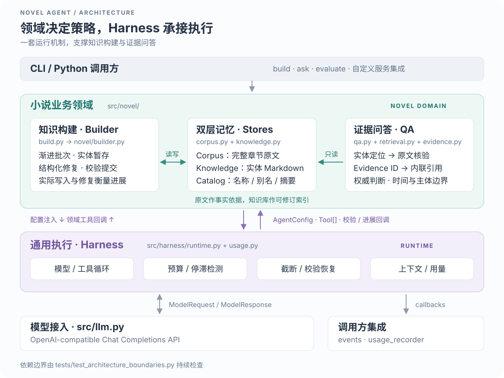
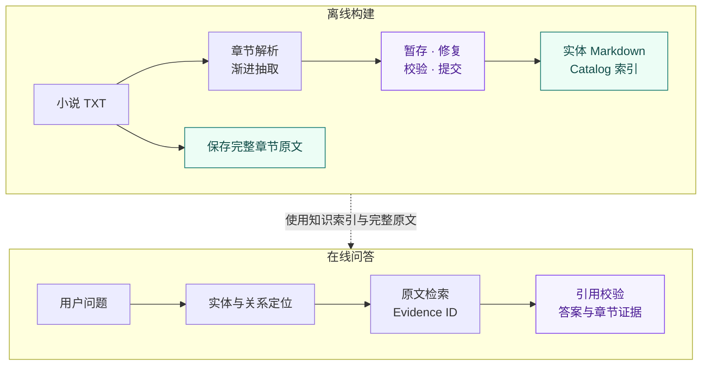
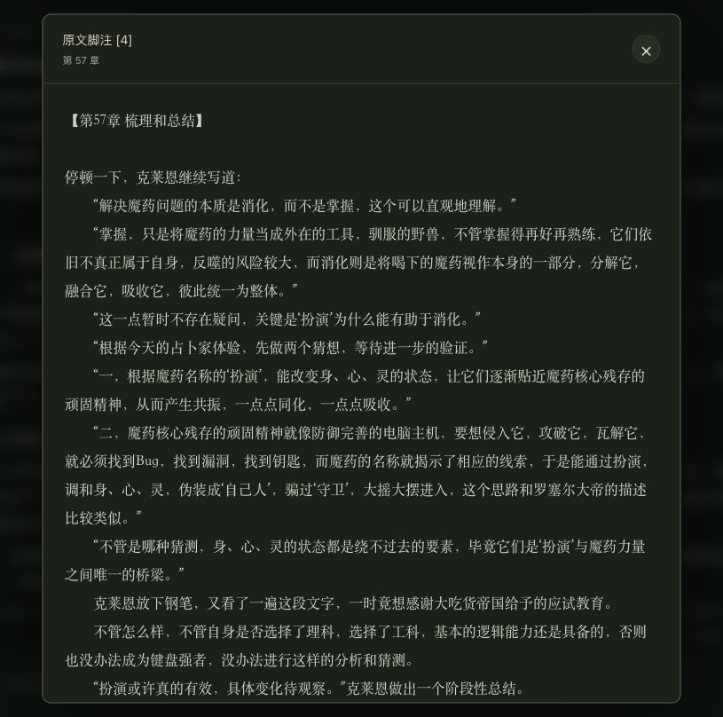
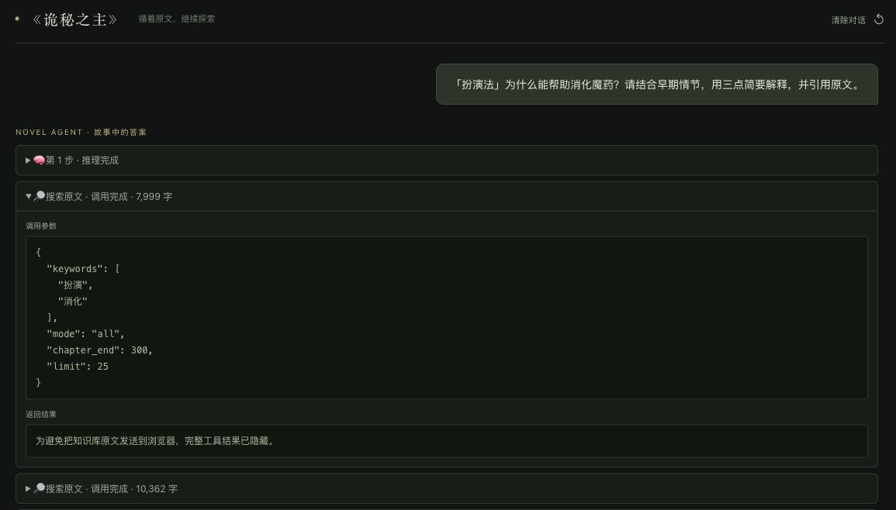
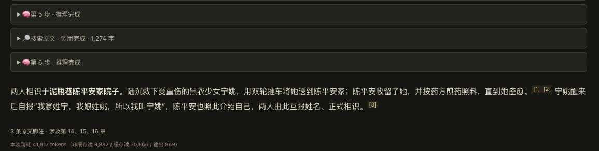
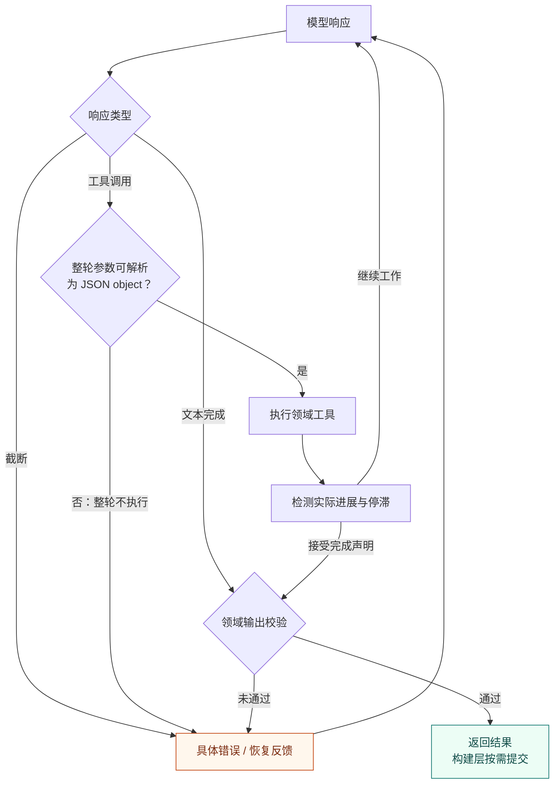

# Novel Agent

**把长篇小说整理成可检查的知识，让每个关键回答都能回到原文。**

Novel Agent 面向长篇小说的知识构建与事实问答：按章节抽取角色、设定、事件与故事弧，保存为 Markdown 实体；提问时先定位知识，再检索原文、核对证据并生成带引用的答案。

同一个人可能有多个名字，传闻可能被后文推翻，一件器物的部件也可能被误算成独立对象。我们把这些小说领域问题，与长任务中的上下文、工具错误、停滞和恢复问题拆开处理：**小说领域层定义怎样做对，通用 harness 层负责在有限预算内执行。**

[整体架构](#整体架构) · [在线体验](#在线体验) · [核心创新点](#核心创新点) · [从源码开始](#从源码开始) · [踩坑与技巧](#踩坑与技巧) · [开发与许可](#开发与许可)

## 整体架构



两个 Agent 共用一个 Runtime：Builder 写入知识，QA 只读检索。领域层向 Runtime 注入 `AgentConfig`、`Tool[]`、进度检测和输出校验回调；Runtime 执行模型与工具循环，把结果交回领域层处理。

| 层 | 负责什么 | 代码入口 |
|---|---|---|
| 小说领域 | 实体与章节、信息取舍、构建暂存和修复、检索策略、证据与引用 | [`src/novel/`](src/novel/) |
| 通用 harness | 模型/工具循环、上下文裁剪、运行预算、停滞检测、截断与校验恢复、用量汇总 | [`src/harness/`](src/harness/) |
| 模型接入与应用集成 | 流式 API、传输重试、CLI、事件转发、用量落盘、可选观测 | [`src/llm.py`](src/llm.py) · [`src/cli.py`](src/cli.py) · [`src/tracing.py`](src/tracing.py) |

例如，“什么才算实体写入有进展”由领域工具的 `progress_detector` 判断；“没有进展多久应当停止”由 Runtime 控制。“哪些原文可以引用”由 `EvidenceCollector` 校验，Runtime 只调用校验器并在失败时安排有限修复。这个边界由[架构测试](tests/test_architecture_boundaries.py)检查，Runtime 不依赖小说模块、模型 SDK 或观测产品。

### 从小说到答案



原文是最终事实来源，知识库是可修订的检索索引。当前使用名称、别名、摘要和原文关键词检索，无需部署向量数据库。QA 的四个工具是 `search_entities`、`read_entity`、`search_source` 和 `read_chapter`；最终脚注只接受本次 `search_source` 取得的原文证据。

## 在线体验

**[打开 Novel Agent 在线示例](https://giwzbqguwjtr.sealosbja.site/?novel=guimi)**，无需本地安装即可体验小说问答与原文引用。

- 使用前需要关联 **GitHub 账号**。
- 使用服务提供的模型时，**每本小说最多体验 3 个问题**。
- 想继续提问，点击输入区域上方的**使用自己的模型**，填写接口地址、模型名称与 API Key。


### 两个真实问答

**设定理解 ·《诡秘之主》：「扮演法」为什么能帮助消化魔药？**

下面是在线服务实际生成的回答片段。可以查看检索步骤，并点击结论旁的脚注回到对应章节。


<details>
<summary>展开这次问答的原文脚注与检索过程</summary>

**点击脚注查看原文。** 浮窗标明章节并展示相关片段，方便读者核对回答的依据。



**展开工具卡片查看查询参数。** 这次检索使用“扮演”“消化”两个关键词，限定章节范围；在线示例隐藏完整工具返回，保留可查看的调用参数。



</details>

**人物相逢 ·《剑来》：陈平安和宁姚是怎样相识的？**

同一套问答流程也能用于人物关系：先查实体和原文，再给出带章节脚注的回答。下面截取这次问答的收尾步骤与回答。



<details>
<summary>切换小说，探索不同故事</summary>

界面支持切换小说，也为每个故事提供不同的提问起点。例如《剑来》中的人物相逢、小镇规矩与修行设定：


</details>

## 核心创新点

| 设计 | 如何落地 | 带来的价值 |
|---|---|---|
| **两层记忆，回答回源** | 完整章节保留事实；实体、别名与关系帮助定位；按章节范围、倒序和分页核查原文 | 让跨章关系、身份变化与后期揭秘有可追溯的核查路径 |
| **模型判断语义，代码维护结构** | 一实体一 Markdown；路径、元数据外壳和 `catalog.jsonl` 由代码生成 | 知识可以直接阅读、检查与比较，模型集中处理抽取和合并 |
| **以校验收尾的渐进构建** | 批内暂存可读可查；显式完成后检查实体、来源章节、链接和未解决失败；成功才提交 | 避免把“模型说完成”直接当成知识库构建成功 |
| **把错误变成可操作的修复任务** | 精确补丁、字段级修复、缺失链接候选、问题 ID 和版本核验 | 小改动用小工具完成，减少反复生成整份实体和猜测路径 |
| **以领域回调连接最小内核** | `Tool` 提供进展与恢复反馈，领域提供完成和校验规则；Runtime 管循环与预算 | 构建与问答复用执行机制，业务规则仍留在小说层 |

长篇构建采用随全书进度逐步缩小的字符窗口，默认从 30K 到 20K；触达运行边界时按章节长度拆分批次，成功子批次立即保存断点。原文内容指纹同时保护续跑，避免把修订前后的文本混进同一份知识库。

仓库附带八章原创短篇《雾港守灯簿》和 14 道评测题，可以直接检查这些问题：

- **别名**：“白鸥和白榆是两个人吗？”
- **部件关系**：“碎星镜和鸣潮灯是什么关系？”
- **传闻纠正**：“连续三次短鸣到底表示什么？陈满最初的说法可靠吗？”
- **完整枚举与未知**：“首次开闸有哪些人参加？”“蓝船最后停靠了哪座岛？”

这些题的原文依据和人工参考答案见[公开样例](examples/mist_harbor/README.md)。样例用于复现流程和观察错误，模型成绩需要另跑真实评测。

本仓库提供领域核心、最小 Runtime、CLI、测试和样例，通过克隆源码安装。在线示例作为独立服务部署，提供界面、GitHub 关联和体验额度；自行集成时可按需实现这些应用能力。

[业务设计](docs/DESIGN.md) · [Harness 边界](docs/HARNESS_ARCHITECTURE.md) · [构建与故障恢复](docs/BUILDING.md)

## 从源码开始

需要 Python 3.11+。下列命令适用于 macOS/Linux，在仓库目录运行：

```bash
git clone https://github.com/logan-zou/novel_agent.git
cd novel_agent
python3 -m venv .venv
.venv/bin/pip install -e .
```

### 1. 先做无模型检查

仓库附带原创短篇《雾港守灯簿》及人工参考答案，无需下载商业小说或配置密钥：

```bash
./novel-agent --help
./novel-agent evaluate --dataset examples/mist_harbor/qa_cases.jsonl
./novel-agent evaluate --dataset examples/mist_harbor/qa_cases.jsonl --responses examples/mist_harbor/reference_responses.jsonl
bash build_many.sh
```

这些命令不调用模型。参考答案用于检查评测流程，不能作为模型准确率成绩。
`build_many.sh` 默认只预览任务；[样例说明](examples/mist_harbor/README.md) 提供原文、逐题依据和完整实验步骤。

### 2. 配置模型

```bash
cp .env.example .env
```

填写实际服务地址、密钥和模型名：

```dotenv
LLM_BASE_URL=https://api.openai.com/v1
LLM_API_KEY=your-api-key
LLM_MODEL=your-model
```

模型服务需支持流式 Chat Completions、tool calling 和 usage 返回。
协议兼容程度和抽取效果取决于服务及模型；请按实际模型设置上下文、输出容量，先跑小样例验证。
推理扩展参数默认关闭，仅在服务商明确支持时开启。

```bash
./novel-agent config
```

配置检查只显示密钥是否存在，不输出密钥。`.env` 与数据目录已被 Git 忽略。

### 3. 构建并提问

以下命令会调用模型并产生服务商费用：

```bash
./novel-agent build examples/mist_harbor/mist_harbor.txt mist_harbor --max-batches 1
./novel-agent ask mist_harbor "碎星镜和鸣潮灯是什么关系？" --json
```

输出默认保存在 `knowledge_base/mist_harbor/`。示例原文很短，默认窗口可在一个批次内处理完。
自己的小说可以用同样方式先试一个批次；去掉 `--max-batches 1` 后执行完整构建。

重新运行相同命令会从已提交批次续跑。章号、标题、正文指纹和已保存章节必须一致；
修订原文请使用新的 `novel_id`。旧进度仅在已存章节完整匹配时迁移，原文不匹配时停止且保留原库。
TXT 输入支持 UTF-8、GB18030 等常见编码。

`ask --json` 返回回答、证据、引用校验和用量。`--show-reasoning` 可显示服务返回的 `reasoning_content`，该字段是可选能力。

服务集成可向 `src.novel.qa.run_qa_agent` 传入 `usage_recorder` 回调，将每轮用量记录到独立数据库，支持只读知识库。省略时保持 CLI 的默认用量文件记录。

### 4. 跑真实问答评测

完成样例知识库构建后，可对同一组问题运行模型评测并保存报告：

```bash
./novel-agent evaluate --dataset examples/mist_harbor/qa_cases.jsonl --live --output knowledge_base/mist_harbor/evaluation.json
```

真实评测会产生模型费用；全部选中案例先检查知识库和章节是否可用。
默认 `evaluate` 只校验数据格式；传 `--responses` 评分已有回答，任何案例不通过时退出码非零。

## 踩坑与技巧

### 小说领域：检索到内容，还要判断它意味着什么

| 遇到的坑 | 我们采用的做法 | 实现与回归测试 |
|---|---|---|
| 同一对象的别名、化身或部件被重复建档、重复计数 | 名称与别名优先定位；写前查重；身份、数量和主体/部件问题回原文核对 | [知识检索](src/novel/knowledge.py) · [问答策略](prompts/qa.md) · [样例测试](tests/test_public_example.py) |
| 后文出现的新说法覆盖了更可靠的旧记录，或结局状态污染了早期问题 | 提示模型区分正式记录、知情说明、转述和猜测；最终口径可倒序找，时间点问题限制章节范围 | [领域提示](prompts/qa.md) · [原文检索](src/novel/corpus.py) |
| 查询前 30 项没有某个实体，就误判它不存在 | 限额按整次查询计算；返回逐词覆盖、截断和未覆盖词，只对缺口缩小补查 | [检索实现](src/novel/knowledge.py) · [覆盖反馈测试](tests/test_entity_search.py) |
| 为了修摘要或一条链接，重写整个实体又引入新错误 | 摘要与正文分字段补丁；旧文本必须唯一匹配；链接修复用问题编号和真实目标，过期版本重新检查 | [修复工具](src/novel/builder.py) · [结构化修复测试](tests/test_structured_repairs.py) |
| 原文悄悄换了版本，旧断点却继续复用 | 核对章号、标题、正文指纹及已保存章节，已完成任务也要核验；修订版使用新 `novel_id` | [构建入口](src/build.py) · [原文身份测试](tests/test_source_identity.py) |

信息权威、身份关系和枚举完整性仍依赖模型理解与检索策略；这些提示和工具让判断更可检查，代码校验本身不保证事实语义正确。

### 通用 harness：工具调用成功，还要判断任务有没有前进

我们把可复用内核收在 `runtime.py` 和 `usage.py`：通用执行机制通过工具与回调复用，实体暂存、批次断点和证据规则由领域维护。原文与知识已经有自己的存储，上下文裁剪后可以重新读取，因而无需再维护一份通用内容存储。这个取舍也让恢复边界更明确：持久断点以已提交批次为单位，运行内的暂存和上下文只在当前进程中延续。



恢复按类型使用有限重试和配置的停滞保护，并受总轮数约束；预算耗尽时退出并交由调用方处理。构建入口可以据此拆批，QA 则返回失败。

| 遇到的坑 | 我们采用的做法 | 实现与回归测试 |
|---|---|---|
| 一轮有多个工具调用，其中一个 JSON 被截断，却先执行了其他写入 | 执行前预检整轮 JSON；有错则整轮拒绝，不把坏工具消息放入历史；回传错误位置与有界摘录，有限重试 | [Runtime](src/harness/runtime.py) · [工具循环测试](tests/test_runtime.py) |
| 工具一直返回“成功”，Agent 却只是在重复搜索或写相同内容 | 由领域 `progress_detector` 判断真实修改；结合相同参数和结果指纹检测停滞，先给恢复建议，继续重复才中止 | [进展检测](src/harness/runtime.py) · [搜索恢复测试](tests/test_entity_search_recovery.py) |
| 一到总轮数就中断，或每次“再试一下”都把预算重置 | 分开工作、收尾、续跑和校验修复窗口；收尾范围由领域限定，续跑保留用量、历史和保护计数 | [Builder 配置](src/novel/builder.py) · [有界续跑测试](tests/test_extraction_continuation.py) |
| 当前数据结构合法，就提前认定抽取结束 | 构建需显式 `finish_batch`；整轮成功后才接受声明，再做领域校验；失败和截断不能触发提交 | [完成协议](src/novel/builder.py) · [批次收尾测试](tests/test_batch_finalization.py) |
| 工具结果堆满上下文，压缩后又找不回依据 | 省略较早的大段工具结果、保留最近结果；原始内容留在领域存储，需要时重新读取 | [上下文裁剪](src/harness/runtime.py) · [Runtime 测试](tests/test_runtime.py) |
| 截断续写或输出修复后，对话缺失服务要求的 `reasoning_content` | 服务返回该字段时，随真实 assistant 消息保留各段内容；最终校验拼接答案，不伪造历史思考 | [消息恢复](src/harness/runtime.py) · [恢复测试](tests/test_reasoning_recovery.py) |

这里有两个容易混淆的边界：**整轮拒绝针对无法解析为 JSON object 的工具参数**；执行阶段的字段或业务错误会保留已成功项，只修失败项。**上下文裁剪针对对话中的旧工具结果**，持久知识仍由领域存储负责。

网络断流的重试留在[模型接入层](src/llm.py)：关闭 SDK 内部重试，每次模型请求使用统一的有限退避预算；失败流的未完成文本和工具参数被丢弃，完整响应返回后才执行工具。构建提交则由 `BuildSession` 先校验，再逐文件替换，发生异常时回滚已写实体；同一知识库采用单进程写入。这些机制的详细范围见 [Harness 边界](docs/HARNESS_ARCHITECTURE.md)与[构建恢复说明](docs/BUILDING.md)。

## 批量构建

```bash
# 只预览输入和输出，不调用模型或创建日志
./novel-agent build-many ./novels --dry-run

# 实际试跑：同时一本，每本最多一个批次
./novel-agent build-many ./novels --workers 1 --max-batches 1

# 使用脚本顶部的输入列表；默认只预览，显式 --run 才实际构建
bash build_many.sh --run
```

脚本默认使用原创样例、1 路并发、1 批上限，关闭调试。完整运行可修改输入列表并用 `--run --max-batches 0`。
实际运行日志和汇总位于 `knowledge_base/_build_logs/`。同一本知识库应仅由一个进程写入。
批次上限下的成功仅表示本次运行成功，整本完成以 `progress.json` 为准。
更多并发、日志和修复规则见 [构建与故障恢复](docs/BUILDING.md)。

## 模型配置

| 配置 | 说明 |
|---|---|
| `LLM_BASE_URL` | Chat Completions `/v1` 地址，默认 `https://api.openai.com/v1` |
| `LLM_API_KEY` | 模型服务密钥，保存在本地 `.env` 或环境变量 |
| `LLM_MODEL` | 构建和问答共用的模型名；也可分别指定下面两个模型 |
| `EXTRACTION_MODEL` / `QA_MODEL` | 覆盖对应任务的模型名 |
| `MODEL_CONTEXT_TOKENS` | 模型上下文容量，用于主动裁剪 |
| `MODEL_MAX_OUTPUT_TOKENS` | 单次调用最大输出，需按模型配置 |
| `MODEL_TEMPERATURE` | 请求温度，默认 0.5，需确认模型支持 |
| `LLM_INCLUDE_REASONING_EFFORT` | 是否发送 `reasoning_effort`，默认关闭 |
| `LLM_ENABLE_THINKING` | 是否发送 thinking 扩展，默认关闭 |
| `LLM_STREAM_MAX_RETRIES` | 网络/流式中断后的额外重试次数，默认 5，0 关闭 |
| `KNOWLEDGE_BASE_DIR` | 知识库根目录，默认源码仓库内 `knowledge_base/` |

环境变量优先于 `.env`。配置模板见 [.env.example](.env.example)。
核心运行依赖只有 `openai`，完整声明在 [pyproject.toml](pyproject.toml)；安装使用本地源码，不需要 PyPI 发布包。
可选观测使用 `.venv/bin/pip install -e '.[observability]'`。

## 效果与费用的边界

公开样例覆盖事实、别名、部件关系、后期反转、枚举和信息不足；另保留两条历史小说 badcase。
评分检查关键词、禁词、预期章节和引用状态。引用有效只证明证据确实读取过，不自动证明每个结论都被证据支持。
人工参考答案的通过率不能代表模型质量；真实效果需记录所用模型、配置、版本、输入输出 token 和时长。

输入/输出 token 来自服务返回的 usage。显示的缓存拆分是按 Agent 请求前缀长度的**估算**，
不代表服务商实际缓存命中或计费；失败流缺失的 usage 也无法计入本地记录。费用以服务商记录为准。
详细规则和真实评测步骤见 [评测说明](evals/README.md)。

## 数据与隐私

`novels/` 和 `knowledge_base/` 默认仅在本地保存，不提交 Git。`examples/mist_harbor/` 是可随源码分发的原创示例，采用本仓库 Apache-2.0 许可。
使用者需有权处理自己的输入文本，商业小说原文和生产知识库不随仓库提供。

构建和问答会把相关原文、知识及问题发送到配置的模型服务。
显式配置 Langfuse 后，问题、回答和运行元数据也会发送到指定观测服务。
开启 `--debug` 会在本地日志保存模型输出及工具内容，分享日志前请删去私有内容和凭证。

## 开发与许可

可以沿两条路径阅读代码：先看领域中的工具与校验如何定义任务，再看 Runtime 如何执行它们。

| 想了解或修改 | 从这里开始 |
|---|---|
| 章节分批、来源核验、拆批与断点 | [`src/build.py`](src/build.py) · [`src/preprocess.py`](src/preprocess.py) |
| 实体存储、暂存会话、Catalog 与修复协议 | [`src/novel/knowledge.py`](src/novel/knowledge.py) |
| 抽取工具、完成声明、收尾与续跑策略 | [`src/novel/builder.py`](src/novel/builder.py) · [`prompts/extraction.md`](prompts/extraction.md) |
| 问答检索与证据协议 | [`src/novel/qa.py`](src/novel/qa.py) · [`src/novel/retrieval.py`](src/novel/retrieval.py) · [`src/novel/evidence.py`](src/novel/evidence.py) |
| 通用执行循环、Provider 契约与用量 | [`src/harness/runtime.py`](src/harness/runtime.py) · [`src/harness/usage.py`](src/harness/usage.py) |

探索其他领域时，可以从 `ChatProvider`、`AgentConfig` 和 `Tool` 接入自己的模型与工具，用进度检测、恢复回调和输出校验表达领域规则。小说专用的实体路径、引用格式和批次存储留在领域层。

欢迎贡献可复现的小说问答 badcase、原创小语料、检索与修复策略，以及 Runtime 边界上的回归案例。先运行离线检查：

```bash
.venv/bin/python -m unittest discover -s tests -v
```

离线测试和 CI 不需要模型密钥。开发流程见 [CONTRIBUTING.md](CONTRIBUTING.md)，
安全报告与集成边界见 [SECURITY.md](SECURITY.md)，变更见 [CHANGELOG.md](CHANGELOG.md)。

本项目采用 [Apache License 2.0](LICENSE)。用户自备小说、生成的知识库和外部服务数据的权利由其来源决定。
